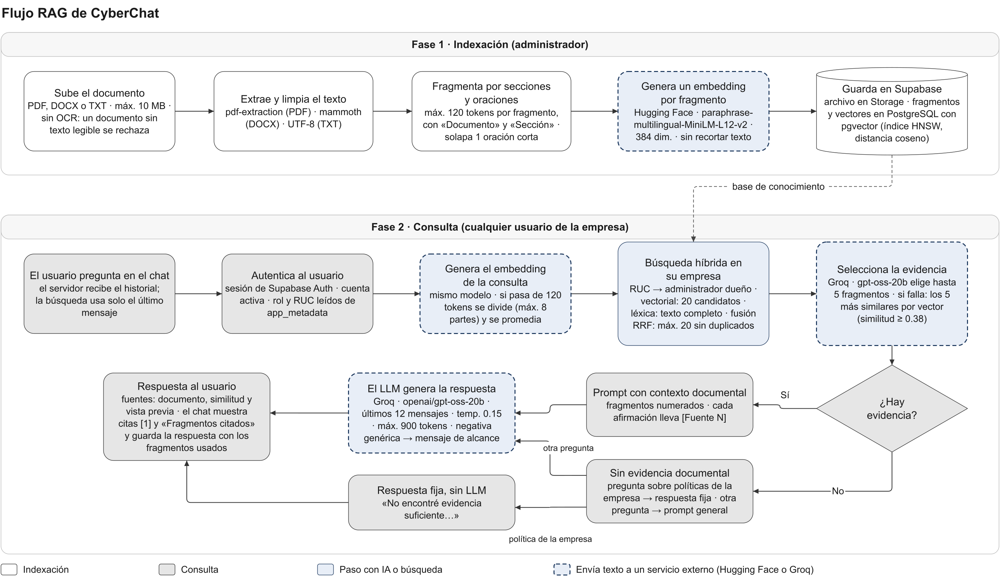

# Flujo RAG — CyberChat

CyberChat usa **RAG (Retrieval-Augmented Generation, generación aumentada por recuperación)**:
antes de que el modelo de lenguaje responda, el sistema busca en los documentos de la empresa los
fragmentos más parecidos a la pregunta y se los entrega como contexto. Así las respuestas se basan
en las políticas reales de cada empresa y no solo en el conocimiento general del modelo.

El flujo tiene dos fases: la **indexación**, cuando el administrador sube un documento, y la
**consulta**, cada vez que alguien le pregunta algo al asistente.

| | Español | English |
|---|---|---|
| Editable (draw.io) | [flujo-rag.drawio](flujo-rag.drawio) | [flujo-rag.en.drawio](flujo-rag.en.drawio) |
| Imagen | [PNG](img/flujo-rag.es.png) · [SVG](img/flujo-rag.es.svg) | [PNG](img/flujo-rag.en.png) · [SVG](img/flujo-rag.en.svg) |

Las cuatro salidas se generan desde una sola definición con `node docs/tools/generar-diagramas.mjs`.

## Tecnologías en cada paso

| Paso | Tecnología |
|---|---|
| Extracción de texto | `pdf-extraction` (PDF), `mammoth` (DOCX) y decodificación UTF-8 (TXT). Máximo 10 MB. No hay OCR: un documento sin texto legible se rechaza |
| Fragmentación | Por secciones (títulos `#`) y oraciones, con un máximo de 120 tokens por fragmento contados con el tokenizador del modelo. Cada fragmento lleva el nombre del documento y de la sección; si cabe, repite la última oración corta (24 tokens o menos) del fragmento anterior. Se quitan los fragmentos repetidos (`lib/ragText.ts`) |
| Embeddings | Hugging Face Inference · `paraphrase-multilingual-MiniLM-L12-v2`, multilingüe, 384 dimensiones. Ningún texto pasa de 120 tokens, así que no se recorta (`lib/embedHF.ts`) |
| Almacenamiento de vectores | PostgreSQL 17 + `pgvector` en Supabase, índice HNSW con distancia coseno |
| Búsqueda híbrida | Vectorial con `match_document_chunks_scoped` (20 candidatos) y léxica de texto completo sobre los mismos documentos (hasta 8 resultados con los términos más específicos y 20 con todos). Las dos listas se combinan con fusión RRF, se quitan duplicados y quedan como máximo 20 candidatos (`lib/ragRetrieval.ts`) |
| Selección de evidencia | Groq · `openai/gpt-oss-20b` (temperatura 0, salida JSON con esquema) elige hasta 5 fragmentos que responden la pregunta. Si falla, se usan los 5 más similares de la búsqueda vectorial con similitud de 0.38 o más |
| Generación | Groq · `openai/gpt-oss-20b`, temperatura 0.15, máximo 900 tokens, con los últimos 12 mensajes de la conversación. Cada afirmación documental se cita como `[Fuente N]` |

## Por qué funciona así

- **Mismo modelo en ambas fases.** La pregunta y los fragmentos se convierten en vectores con el
  mismo modelo; solo así la distancia entre ellos mide qué tan parecido es su significado.
- **Fragmentos cortos y con contexto.** El modelo de embeddings solo procesa un número limitado de
  tokens; con 120 como máximo ningún fragmento se recorta. El nombre del documento y de la sección
  ayudan a que cada fragmento se entienda por sí solo.
- **Búsqueda híbrida.** La búsqueda vectorial encuentra fragmentos con el mismo significado aunque usen
  otras palabras; la léxica encuentra términos exactos (por ejemplo, nombres de sistemas o cifras).
  Combinarlas reduce los fragmentos relevantes que se pierden.
- **Selección con IA.** Entre los candidatos, el modelo elige los que realmente responden la pregunta,
  en lugar de quedarse solo con los más parecidos.
- **Aislamiento por empresa.** El RUC sale de `app_metadata` en la sesión del usuario, nunca de lo que
  envía el navegador, y con él se busca al administrador dueño de los documentos. Si no existe, se usa
  el id del propio usuario, así que nunca se recuperan documentos de otra empresa.
- **Solo el último mensaje busca.** El servidor recibe el historial, pero la búsqueda se hace
  únicamente con el último mensaje del usuario. Si pasa de 120 tokens, se divide (hasta 8 partes) y se
  promedian sus vectores.
- **No inventa políticas.** Si no hay evidencia y la pregunta es sobre las políticas de la empresa, el
  sistema responde «No encontré evidencia suficiente…» sin llamar al modelo. Si es otra pregunta, el
  asistente responde con conocimiento general.
- **Alcance limitado.** El prompt de sistema restringe al asistente a temas de ciberseguridad. Si el
  modelo devuelve una negativa genérica, se reemplaza por un mensaje que explica su alcance.
- **Fuentes visibles.** Cada respuesta muestra citas numeradas ([1], [2]…) y la sección «Fragmentos
  citados». El navegador guarda la respuesta junto con los fragmentos usados (`messages.retrieved_contexts`).
